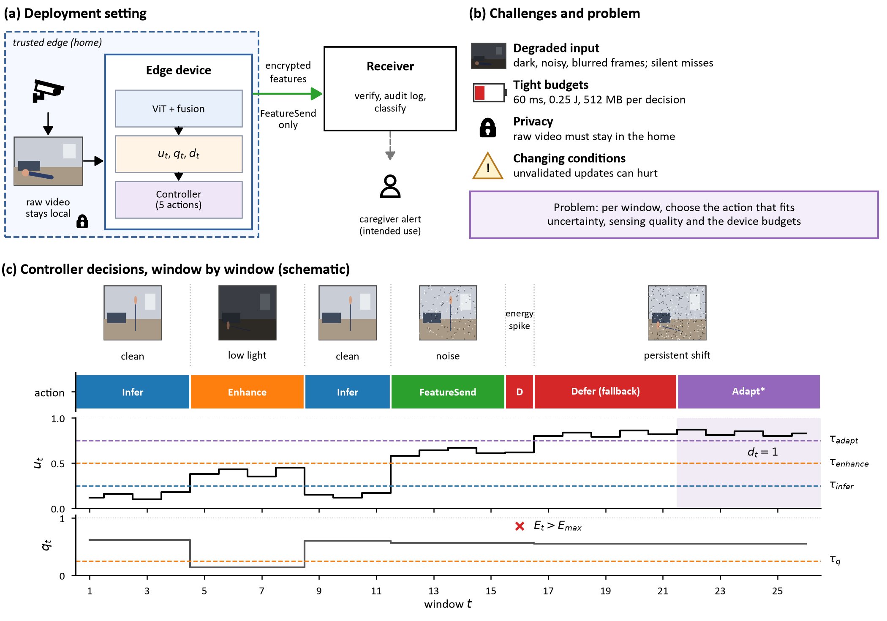

# Agentic Edge Vision

[](https://doi.org/10.5281/zenodo.24623334)

Code and data for **Agentic Edge Vision with Privacy-Conscious Communication for Human-Centered Pervasive Computing**.



## Overview

This repository implements a resource-aware fall detection framework for edge devices. The system combines a compact Vision Transformer (AgenticViT) with an uncertainty-driven agentic controller that selects one of five actions — *Infer*, *Enhance*, *FeatureSend*, *Defer*, or *Adapt* — based on real-time resource state and model confidence. Only compressed feature vectors are transmitted; raw video never leaves the device.

## Results

| Model | Params (M) | Test Accuracy | Test Macro-F1 | Jetson Latency (ms) |
|---|---|---|---|---|
| MobileNetV3-Small | 1.52 | 89.1% | 0.890 | — |
| EfficientNet-B0 | 4.01 | 90.9% | 0.908 | — |
| AgenticViT (ours) | 5.72 | 92.6% | 0.924 | 27.4 |

Evaluated on the LE2I fall detection dataset. Full results in `results/`.

## Repository Structure

```
src/           # Model, controller, training, evaluation, privacy
scripts/       # Ablation, sensitivity, Jetson profiling, figure generation
figures/       # Plots
results/       # CSV result tables
checkpoints/   # Saved weights (3 models × 5 seeds)
data/          # Embeddings and dataset splits
predictions/   # Sample prediction frames
```

## Installation

```bash
pip install -r requirements.txt
```

Requires Python 3.10+, PyTorch 2.3.

## Usage

```bash
# Train
python src/train.py --seed 42 --epochs 60 --data-root /path/to/LE2I

# Evaluate
python src/evaluate.py --checkpoint checkpoints/best_checkpoint.json

# Reproduce figures
python scripts/plot_figures.py
```

## Citation

```bibtex
@dataset{agenticedgevision2026,
  title  = {Agentic Edge Vision: Privacy-Conscious Communication for Human-Centered Pervasive Computing},
  author = {Khan, Abuzar},
  year   = {2026},
  doi    = {10.5281/zenodo.24623334},
  url    = {https://doi.org/10.5281/zenodo.24623334}
}
```

## License

MIT — see [LICENSE](LICENSE).
