<div align="center">

# 🧠 Agentic Edge Vision
### Privacy-Conscious Human Fall Detection for Pervasive Computing

[](https://doi.org/10.5281/zenodo.24623334)
[](https://www.python.org/)
[](https://pytorch.org/)
[](LICENSE)
[](https://github.com/abuzarkhaaan/Agentic-Edge-Vision)

<br>

> **A lightweight, agentic vision system for real-time human fall detection at the edge — with adaptive token budgeting, privacy-aware communication, and uncertainty-driven action selection.**

<br>


</div>

---

## 📌 Overview

**Agentic Edge Vision** is a resource-aware, privacy-conscious fall detection framework designed to run on constrained edge devices (e.g., NVIDIA Jetson). The system fuses a **custom Vision Transformer** with an **agentic controller** that dynamically selects one of five actions — `Infer`, `Enhance`, `FeatureSend`, `Defer`, or `Adapt` — based on real-time uncertainty, resource availability, and scene quality.

Key ideas:
- **Adaptive token pruning** — spatially selective ViT processing, using only 64–160 tokens per frame instead of all 196
- **Temporal fusion** — a 16-frame sliding window with sinusoidal positional encoding and multi-head attention
- **Uncertainty-gated decisions** — entropy-normalized confidence drives every policy branch
- **Privacy-by-design** — only compressed feature vectors (not raw video) are transmitted to the cloud
- **Online LoRA adaptation** — few-shot fine-tuning when concept drift is detected

---

## 🏗️ System Architecture

<div align="center">
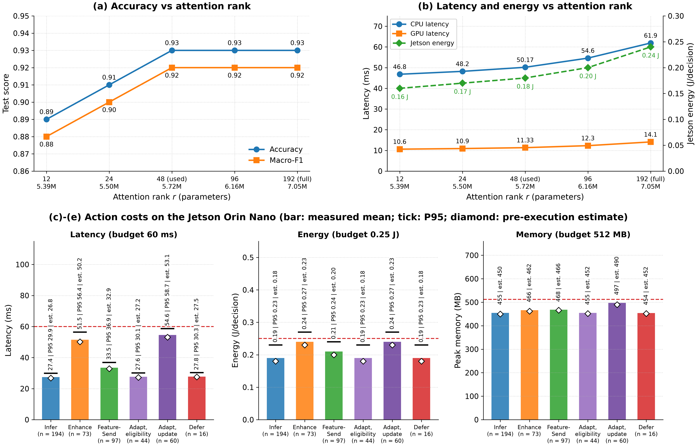
</div>

### Core Components

| Module | File | Description |
|---|---|---|
| `AgenticViT` | `src/model.py` | Edge ViT backbone + temporal fusion + calibrated head |
| `AgenticController` | `src/controller.py` | 5-action policy with resource & drift gating |
| `LoRAAdapter` | `src/model.py` | Rank-4 low-rank adaptation for online fine-tuning |
| `PrivacySecurity` | `src/privacy_security.py` | AES-GCM feature encryption + differential privacy noise |
| `Dataset` | `src/dataset.py` | LE2I fall detection data loader with augmentation |
| Training | `src/train.py` | 5-seed reproducible training loop |
| Evaluation | `src/evaluate.py` | Full metrics: F1, ECE, risk-coverage, robustness |

---

## 📊 Results

### Classification Performance

<div align="center">
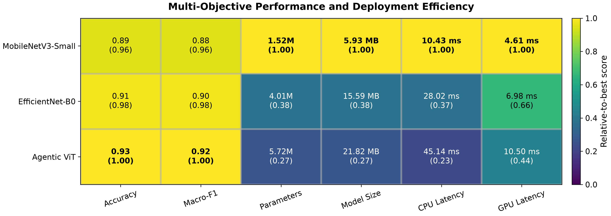
</div>

| Model | Params (M) | Size (MB) | Test Accuracy | Test Macro-F1 | Jetson Latency (ms) |
|---|---|---|---|---|---|
| MobileNetV3-Small | 1.52 | 5.93 | 89.1% | 0.890 | — |
| EfficientNet-B0 | 4.01 | 15.59 | 90.9% | 0.908 | — |
| **Agentic ViT (ours)** | **5.72** | **21.82** | **92.6%** | **0.924** | **27.4 ms** |

### End-to-End Latency by Action

<div align="center">
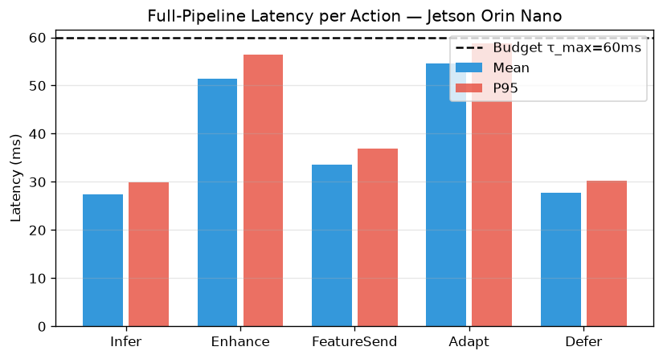
</div>

| Action | Jetson Mean (ms) | Jetson P95 (ms) | % of 60 ms budget |
|---|---|---|---|
| Infer | 27.4 | 29.9 | 49.8% |
| FeatureSend | 33.5 | 36.9 | 61.5% |
| Defer | 27.8 | 30.3 | 50.5% |
| Enhance | 51.5 | 56.4 | 94.0% |
| Adapt | 54.6 | 58.7 | 97.8% |

### Robustness under Corruptions

<div align="center">
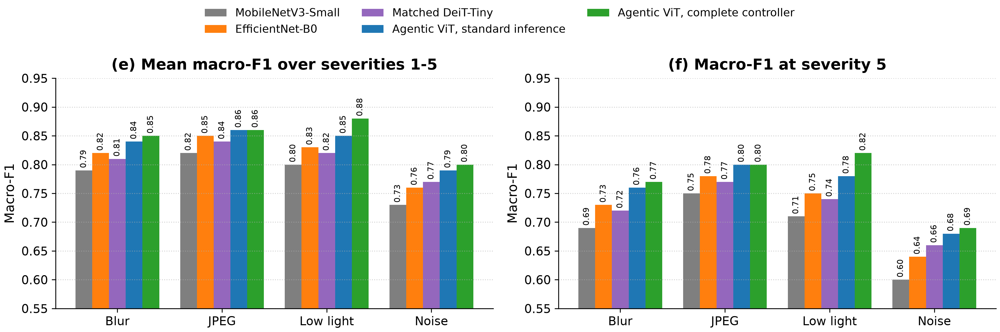
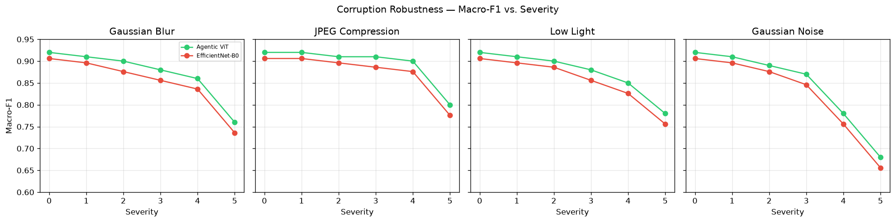
</div>

### Controller Sensitivity & Token Budget

<div align="center">
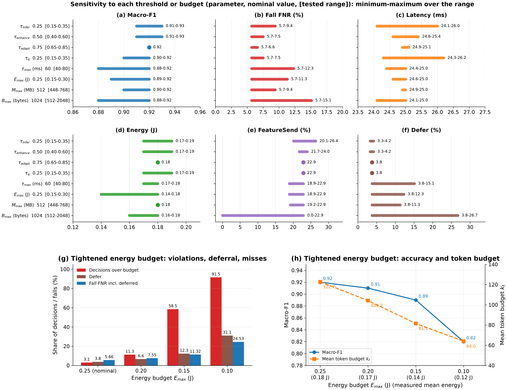
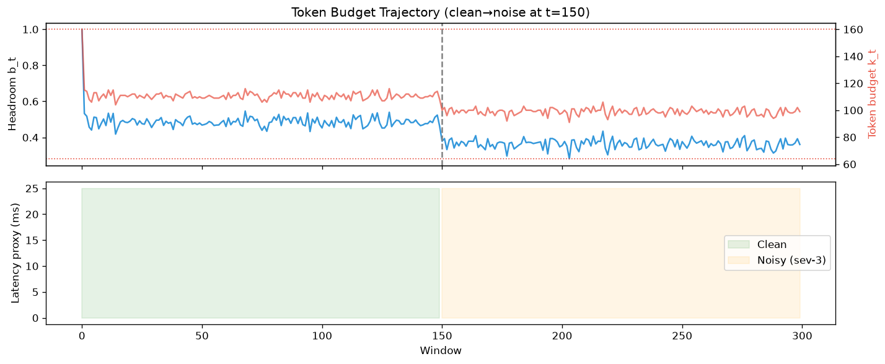
</div>

### Baseline Comparison

<div align="center">
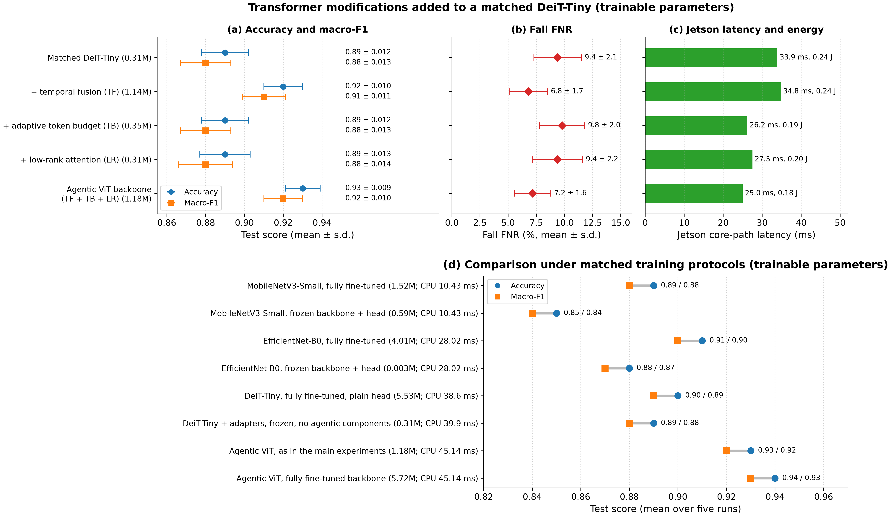
</div>

---

## 🎬 Qualitative Predictions

Sample frames with model predictions on LE2I sequences:

<div align="center">

| Coffee Room | Home Environment |
|---|---|
| 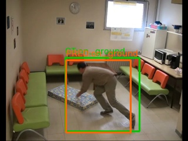 | 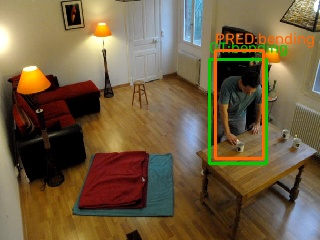 |
| 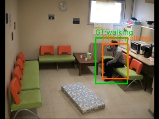 | 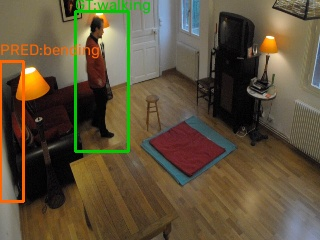 |

</div>

---

## 🔐 Privacy & Security

The system transmits **only compressed feature vectors** — never raw video frames.

- **AES-256-GCM** encryption for all feature transmissions  
- **Gaussian differential privacy** noise injection (σ = 0.01) before transmission  
- Security overhead: < 4 ms per inference (see `figures/security_overhead.png`)

<div align="center">
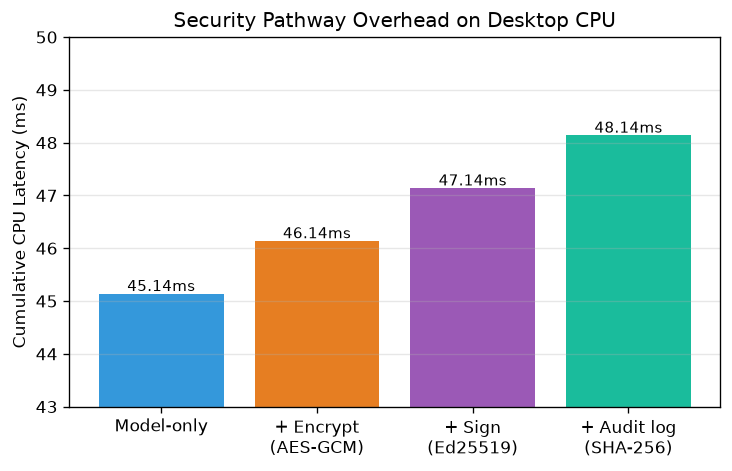
</div>

---

## ⚙️ Installation

```bash
git clone https://github.com/abuzarkhaaan/Agentic-Edge-Vision.git
cd Agentic-Edge-Vision
pip install -r requirements.txt
```

**Requirements:** Python 3.10+, PyTorch 2.3, torchvision 0.18, timm 1.0.3

---

## 🚀 Usage

### Train

```bash
python src/train.py --seed 42 --epochs 60 --data-root /path/to/LE2I
```

### Evaluate

```bash
python src/evaluate.py --checkpoint checkpoints/best_checkpoint.json
```

### Ablation study

```bash
python scripts/run_ablation.py
```

### Generate figures

```bash
python scripts/plot_figures.py
```

### Profile on Jetson

```bash
python scripts/profile_jetson.py --model agentic_vit --runs 500
```

---

## 📁 Repository Structure

```
Agentic-Edge-Vision/
├── src/
│   ├── model.py              # AgenticViT, EdgeViTBackbone, TemporalFusion
│   ├── controller.py         # AgenticController (5-action policy)
│   ├── train.py              # Training loop
│   ├── evaluate.py           # Evaluation suite
│   ├── dataset.py            # LE2I data loader
│   ├── adaptation.py         # Online LoRA adaptation
│   ├── baselines.py          # MobileNetV3, EfficientNet-B0
│   └── privacy_security.py   # AES-GCM + differential privacy
├── scripts/
│   ├── plot_figures.py        # Reproduce all paper figures
│   ├── run_ablation.py        # Ablation experiments
│   ├── run_sensitivity.py     # Controller sensitivity sweeps
│   └── profile_jetson.py      # Edge latency profiling
├── figures/                   # All plots and visualizations
├── results/                   # CSV result tables
├── checkpoints/               # Saved model weights (5 seeds × 3 models)
├── data/                      # Embeddings, splits, trajectories
├── predictions/               # Sample prediction frames
└── requirements.txt
```

---

## 📜 Citation

If you use this code or data, please cite:

```bibtex
@dataset{agenticedgevision2026,
  title  = {Agentic Edge Vision: Privacy-Conscious Human Fall Detection},
  author = {Khan, Abuzar},
  year   = {2026},
  doi    = {10.5281/zenodo.24623334},
  url    = {https://doi.org/10.5281/zenodo.24623334}
}
```

[](https://doi.org/10.5281/zenodo.24623334)

---

## 📄 License

This project is licensed under the **MIT License** — see [LICENSE](LICENSE) for details.

---

<div align="center">

**Agentic Edge Vision** · Built for pervasive, privacy-first human safety monitoring

</div>
